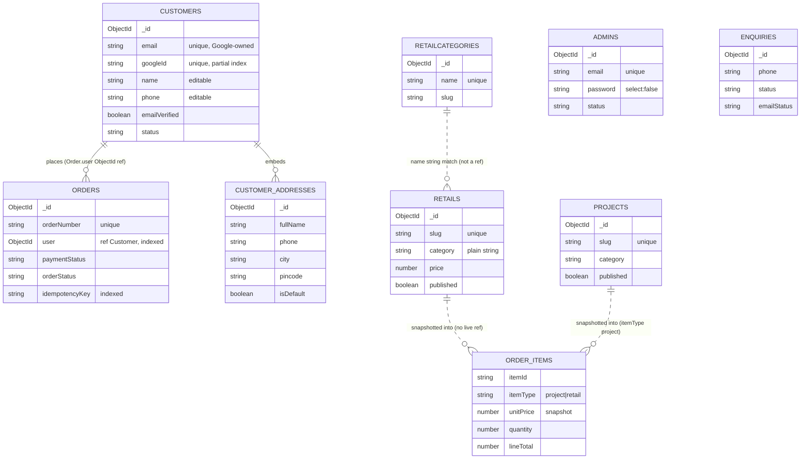
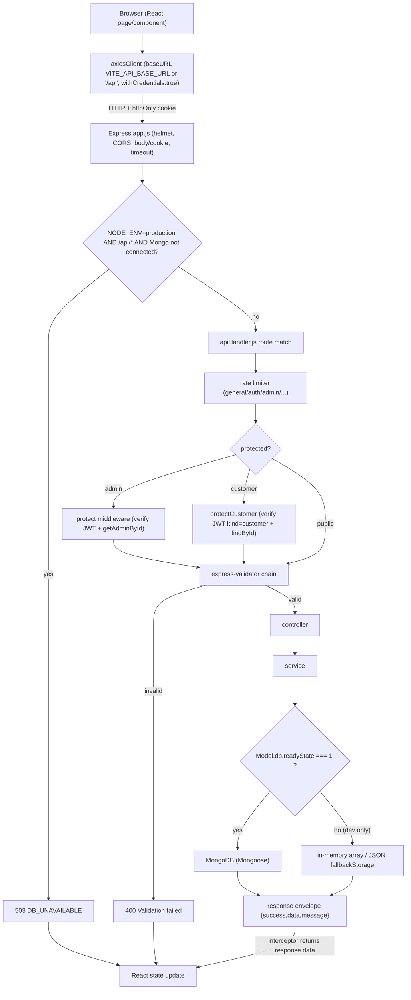
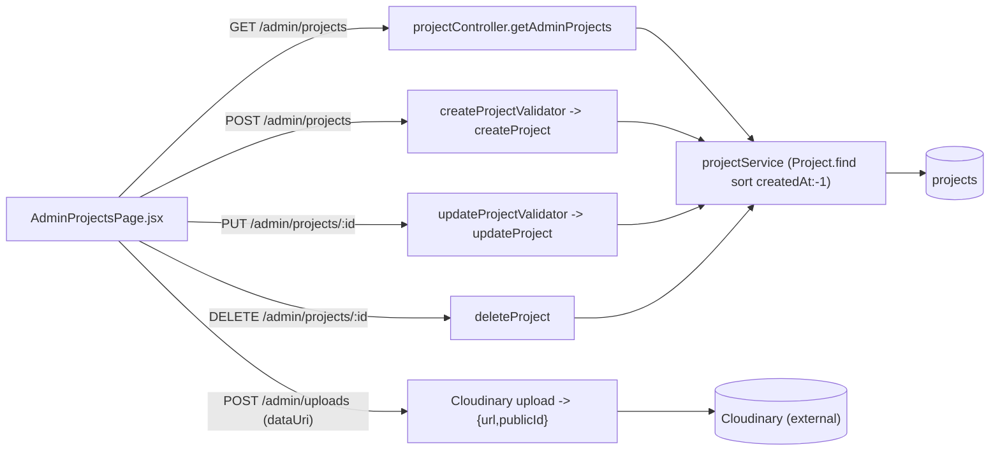
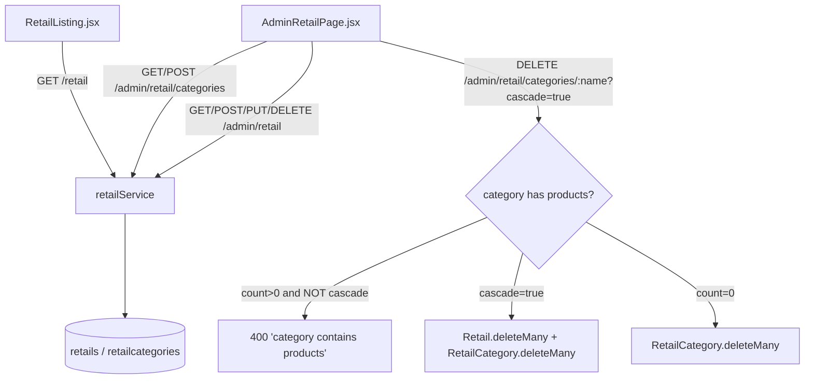

# SabrStudio — Database, Backend & Data-Flow Audit (`dataBase.md`)

> **Evidence-based audit.** Every model name, collection name, field, endpoint, index and
> behaviour below was read from the actual repository source on branch `fazal`
> (repository `https://github.com/abufazal460/Sabr-Studio`). File paths and line numbers are
> given so any claim can be re-checked. Where a behaviour is **proposed** or **inferred**
> rather than implemented, it is labelled explicitly. Nothing here was invented.
>
> **Legend used throughout**
> - **[IMPLEMENTED]** — confirmed present in source code (file:line given).
> - **[VERIFIED]** — confirmed by actually running a command during this audit (output quoted).
> - **[INFERRED]** — logical consequence of the code, not directly executed.
> - **[PROPOSED]** — a recommendation that is **not** in the codebase today.
> - **[NOT VERIFIED]** — could not be confirmed because live database / third-party access was unavailable.

---

## 1. Project overview and scope

SabrStudio is a MERN monorepo for an architecture/interior studio with an e-commerce ("Retail")
arm, an enquiry ("Contact") pipeline, customer accounts, and an admin dashboard.

- **Frontend:** React 18 + Vite 5 + Tailwind + Framer Motion (`frontend/`).
- **Backend:** Node.js ≥ 20, Express 4, **ES modules** (`backend/`, `"type": "module"` in
  `backend/package.json:5`). Routing is a **custom string-matching router** in
  `backend/apiHandler.js`, not `express.Router`.
- **Database:** MongoDB via **Mongoose 8** (`backend/package.json:26`), pointed at **MongoDB Atlas**
  through `MONGODB_URI`.
- **Auth:** JWT in httpOnly cookies — separate **admin** and **customer** identities. Customers
  authenticate with **Google Sign-In only** (server-verified ID token, no password, no OTP).
- **Payments:** Razorpay (server-side order creation + HMAC signature verification + webhook).
- **Media:** Cloudinary (admin uploads).
- **Email:** EmailJS (server-side REST).
- **Deployments:** existing **Vercel** (static frontend + serverless `/api`) preserved; **Hostinger
  managed Node.js** single-app (same-domain SPA + API) is the new target.

**Scope of this document:** how the application *actually* stores and retrieves data, what is
missing, and how MongoDB should be configured/operated in production. It is **not** a generic
MongoDB tutorial. Proposed changes are separated from current behaviour.

**Out of scope / not done here:** no source file other than this `dataBase.md` was created or
modified; no production record was read-modify-written; no collection or index was created.

---

## 2. Current repository architecture

```
Sabr-Studio/
├── package.json              # root orchestration (build/dev/test scripts only)
├── vercel.json               # Vercel: static frontend + /api rewrite to api/index.js
├── api/index.js              # Vercel serverless entry: `export default app` from backend/app.js
├── scripts/
│   ├── build.mjs             # production frontend build (vite build -> frontend/dist)
│   ├── dev.mjs               # local dev orchestration
│   └── test-all-routes.mjs   # existing route/API test harness (root `npm test`)
├── frontend/                 # React + Vite SPA (src/features/**, src/shared/**)
│   ├── vite.config.js        # dev proxy /api,/health -> http://127.0.0.1:3000 (port 5173)
│   └── .env / .env.example
└── backend/
    ├── server.js             # production entry (`npm start`); reads process.env.PORT
    ├── hostinger.cjs         # CommonJS bridge -> imports server.js (Hostinger "Entry file")
    ├── dev.js                # local dev entry (nodemon); seeds dev data; graceful shutdown
    ├── app.js                # Express app: helmet, CORS, body/cookie parse, DB guard, SPA, router
    ├── apiHandler.js         # custom router (path/method matching + middleware chains)
    ├── config/db.js          # single shared Mongoose connection (globalThis-cached)
    ├── models/               # 7 files -> 8 Mongoose models (see §4)
    ├── controllers/          # 7 controllers
    ├── services/             # 10 services (data access + integrations)
    ├── middlewares/          # protect, protectCustomer, rateLimit, validation, error, timeout
    ├── validators/           # express-validator chains
    ├── constants/            # orderStatus, paymentStatus enums
    ├── utils/                # fallbackStorage, seedDevelopmentData, envCheck, cookieOptions, ...
    └── data/fallback/        # JSON fallback files (orders/enquiries) when Mongo is down (dev)
```

**Request entry points**
- **Vercel:** `vercel.json` rewrites `/api/(.*)` and `/health` to `api/index.js`, and `/(.*)` to
  `/index.html` (static `frontend/dist`). `api/index.js:5` imports the same `backend/app.js`.
- **Hostinger / long-lived Node:** `backend/hostinger.cjs` → `backend/server.js` → `app.listen(PORT)`.
  When `SERVE_FRONTEND=true`, the **same Express app** also serves `frontend/dist` and an SPA
  fallback (`backend/app.js:134-139`, `224-229`). **[IMPLEMENTED]**
- **Local dev:** Vite on `:5173` proxies `/api` and `/health` to the backend on `:3000`
  (`frontend/vite.config.js:111-146`). **[IMPLEMENTED]**

**Layering:** `apiHandler` (route match) → middleware chain (rate limiter → `protect`/`protectCustomer`
→ express-validator) → controller → service → Mongoose model → MongoDB. Services contain the
data-access logic and the in-memory/JSON fallback; controllers are thin and map errors to HTTP.

---

## 3. MongoDB architecture and connection flow

### 3.1 Driver, connection module and lifecycle **[IMPLEMENTED]**

- **Driver/ODM:** Mongoose 8 (`backend/package.json:26`). No native `mongodb` driver usage in app
  code (the `mongodb` package present in `node_modules` is Mongoose's own dependency).
- **Single shared connection:** `backend/config/db.js` caches the connection on
  `globalThis.__sabrMongo` (`db.js:5`) so warm serverless invocations reuse one connection.
- **Connect call:** `mongoose.connect(uri, { bufferCommands: true })` (`db.js:28-30`).
  - **No** explicit `maxPoolSize`, `minPoolSize`, `serverSelectionTimeoutMS`, `connectTimeoutMS`,
    `retryWrites`, `readPreference`, `readConcern` or `writeConcern` are passed → **MongoDB Node
    driver defaults apply** (not overridden in code).
  - `bufferCommands: true` → Mongoose queues commands briefly while a background connect is in flight.
- **Database name:** taken from the **path segment of `MONGODB_URI`**; it is **not** set anywhere in
  code. There is no hardcoded DB name. The actual production name is whatever the URI path specifies.
  **[NOT VERIFIED]** — see §3.5 (live connection was blocked by the Atlas IP allow-list during this audit).
- **Where connect is called:**
  - `backend/app.js:244` — background `connectDB()` at import time (non-blocking).
  - `backend/server.js:41` — `await connectDB()` before `app.listen` (production entry).
  - `backend/dev.js` — connects via `app.js` import; then `seedDevelopmentData()` after listen.
- **Failure behaviour:** `connectDB()` **never throws/crashes**. No URI → logs
  `[db] MONGODB_URI not set` and returns `null` (`db.js:20-23`). Connect error → logs a sanitized
  `err.message`, clears the cached promise, returns `null` (`db.js:36-39`).
- **Graceful shutdown:** `backend/dev.js:37-68` closes the HTTP server, **syncs fallback JSON → Mongo**
  (`syncFallbackToMongoose`), then `clearAllFallbackData()`. `backend/server.js:54-60` closes the
  server on SIGTERM/SIGINT (15 s force-exit). Neither calls `mongoose.disconnect()` explicitly —
  process exit closes sockets. **[IMPLEMENTED]**
- **Health check:** `GET /health` (`backend/app.js:161-192`) reports
  `database.status`/`database.state` from `mongoose.connection.readyState` plus fallback counts.
  `GET /api/health` returns `{status:'ok'}` (`apiHandler.js:219-221`).

### 3.2 Connection reuse & the serverless multi-connection risk

- **Hostinger (long-lived Node):** one process → one shared connection (ideal). **[INFERRED]**
- **Vercel (serverless):** the `globalThis` cache reuses a connection **per warm instance**, but each
  cold lambda/instance opens its **own** connection. Under high concurrency many instances → many
  simultaneous Atlas connections, which can approach the Atlas connection limit for the tier.
  This is a known serverless characteristic, not a bug. **[INFERRED]**

### 3.3 Startup when MongoDB is unavailable — production fail-safe **[IMPLEMENTED + VERIFIED]**

`backend/app.js:204-215` registers a guard **before** the API router:

```js
app.use('/api', async (req, res, next) => {
  if (process.env.NODE_ENV !== 'production') return next();
  if (req.path === '/health') return next();
  if (mongoose.connection.readyState === 1) return next();
  try { await connectDB(); } catch { /* sanitized response below */ }
  if (mongoose.connection.readyState === 1) return next();
  return res.status(503).json({ success:false, message:'Service temporarily unavailable. Please try again shortly.', code:'DB_UNAVAILABLE' });
});
```

So in production, if Atlas is unreachable, **every `/api/*` route (except health) returns
`503 DB_UNAVAILABLE`** — the app never silently serves in-memory/demo data. Development keeps the
in-memory fallback so local work needs no Atlas.

**[VERIFIED]** during this audit with an isolated boot (`NODE_ENV=production`, `MONGODB_URI` forced
empty, `PORT=3999`, `SERVE_FRONTEND=true`):

```
GET /health        -> 200  {"data":{"database":{"status":"disconnected","state":0}, ...}}
GET /api/health    -> 200  {"status":"ok"}
GET /api/projects  -> 503  {"success":false,"code":"DB_UNAVAILABLE", ...}
POST /api/auth/login -> 503 (guard blocks before auth)
GET /              -> 200  <!DOCTYPE html> ...   (SPA served)
GET /projects      -> 200                        (SPA deep-link refresh, no 404)
```

The `[env]` startup check (`backend/utils/envCheck.js`) printed **variable names only, never values**,
and warned: `MONGODB_URI is not set — app boots but /api/* returns 503 DB_UNAVAILABLE`.

> **Important gap [IMPLEMENTED-DEFECT]:** the guard keys only on **connection state**, not on
> **emptiness**. If Mongo **is connected** but a collection is empty, the *public* project/retail
> reads still fall through to hardcoded demo arrays — see §27 (Defect D2).

### 3.4 Automatic index creation

Mongoose `autoIndex` is **not** explicitly configured, so it uses the Mongoose default (`true`):
indexes declared on the schemas (§17) are built automatically when the connection opens. There is
**no** separate `createIndex` migration script and **no** `syncIndexes()` call. **[IMPLEMENTED/INFERRED]**

### 3.5 Live connection status during this audit **[NOT VERIFIED]**

A **read-only** inventory probe (`listCollections` + `countDocuments`, no writes) was attempted
against the configured Atlas cluster. It failed at the network layer:

```
RESULT=CONNECT_FAILED
REASON=MongooseServerSelectionError: Could not connect to any servers in your MongoDB Atlas
cluster. One common reason is that you're trying to access the database from an IP that isn't
whitelisted
```

Therefore the **physical** collection inventory, document counts and live index list could **not**
be confirmed from this environment. The operator must verify them in the Atlas Data Explorer
(§21) from an allow-listed IP. The host machine's outbound IP is **not** necessarily the Hostinger
server IP `145.79.209.35`; the Atlas Network Access list must include the **actual runtime egress
IP** of whatever host runs the backend.

### 3.6 MongoDB concepts (quick reference)

- **Cluster** — the Atlas deployment (replica set / shards) hosting one or more databases.
- **Database** — a namespace of collections; here selected by the `MONGODB_URI` path.
- **Collection** — a group of documents (≈ table). Created lazily on first write (§20).
- **Document** — a BSON record (≈ row). `_id` is the primary key.
- **Field** — a key/value in a document (≈ column); schemas are flexible per document.
- **ObjectId** — the 12-byte default `_id`; the 24-hex string form is what URLs carry. Code guards
  casts with `/^[0-9a-fA-F]{24}$/` before using a value as `_id` (e.g. `order.service.js:123`).
- **Index** — a structure that speeds reads; every collection has a default unique `_id` index.

---

## 4. Actual collection inventory

**8 Mongoose models are declared across 7 files.** Mongoose derives the collection name by
lower-casing and pluralising the model name. Physical existence in Atlas was **not** verifiable from
this environment (§3.5); a model declaration does **not** guarantee the collection exists until the
first write (§20).

| Collection (Mongoose default) | Model | Source file | Purpose | Created by | Read by | Updated by | Deleted by | Status |
|---|---|---|---|---|---|---|---|---|
| `admins` | `Admin` | `backend/models/admin.model.js` | Admin dashboard accounts | `auth.service.js` first-run bootstrap (prod) / seed | `protect`, `auth.service.loginAdmin/getAdminById` | `loginAdmin` (lastLoginAt) | — (no admin-delete route) | Declared; **live count [NOT VERIFIED]** |
| `customers` | `Customer` | `backend/models/customer.model.js` | Shopper accounts, addresses (embedded) | `customer.service` google/profile/lastLogin | `protectCustomer`, `customer.service`, `address.controller` | profile/address/lastLogin updates | — (no customer-delete route) | Declared |
| `projects` | `Project` | `backend/models/project.model.js` | Portfolio projects + content blocks | admin `POST /api/admin/projects`; dev seed | public `/api/projects`, admin list | admin `PUT/PATCH` | admin `DELETE` | Declared |
| `retails` | `Retail` | `backend/models/retail.model.js` | Retail products | admin `POST /api/admin/retail`; dev seed | public `/api/retail`, admin, checkout price lookup | admin `PUT/PATCH` | admin `DELETE`; category cascade | Declared |
| `retailcategories` | `RetailCategory` | `backend/models/retail.model.js` | Product category list | admin `POST /api/admin/retail/categories` | `GET /api/admin/retail/categories` | — (no category-update route) | admin `DELETE .../categories/:name` | Declared |
| `orders` | `Order` | `backend/models/order.model.js` | Orders, line-item snapshots, payment, status | `POST /api/orders/checkout` (+ legacy `/api/checkout`) | customer `/api/orders/my*`, admin `/api/admin/orders*` | verify (paid), admin status/tracking, webhook | — (no order-delete route) | Declared |
| `enquiries` | `Enquiry` | `backend/models/enquiry.model.js` | Contact-form leads + email status | `POST /api/enquiries` | admin `/api/admin/enquiries*` | admin status `PATCH`; email-status patch | admin `DELETE` | Declared |
| `otpcodes` | ~~`OtpCode`~~ | — | **Removed** (phone OTP dropped) | — | — | — | legacy collection may still exist; TTL expires it | Removed |

**Domains investigated but with NO dedicated collection (by design):**
- **Order line items** → embedded `items[]` subdocuments in `orders` (§6.5), not a separate collection.
- **Payment records** → embedded `payment` subdocument in `orders`, not a separate collection.
- **Addresses** → embedded `addresses[]` subdocuments in `customers`, not a separate collection.
- **Category↔product link** → a **string** `category` field on `retails` (denormalised), not a reference.
- **Audit logs** → **not implemented**; the closest is the embedded `statusHistory` on orders, which
  is currently **not persisted in Mongo** (§27 Defect D1).
- **Enquiry status history** → **not implemented**; only the current `status` field is stored.

No collection is proposed purely to "complete" this table; §6 lists only justified proposals.

---

## 5. Detailed schema documentation for each collection

Field types are Mongoose types. "R" = required, "U" = unique. Timestamps `{ timestamps:true }` add
`createdAt`/`updatedAt` automatically unless noted.

### 5.1 `Admin` — `admins` (`backend/models/admin.model.js`)

| Field | Type | Constraints / default |
|---|---|---|
| `name` | String | R, trim |
| `email` | String | R, **U**, lowercase, trim, `match /^\S+@\S+\.\S+$/` |
| `password` | String | R, `select:false` (never returned by default) |
| `role` | String | enum `['admin']`, default `'admin'`, R |
| `status` | String | enum `['active','disabled']`, default `'active'`, R |
| `lastLoginAt` | Date | default `null` |
| `createdAt/updatedAt` | Date | timestamps |

- **pre-save hook:** bcrypt-hashes `password` (10 salt rounds) when modified (`admin.model.js:48-57`).
- **instance method:** `comparePassword(candidate)` → `bcrypt.compare` (`:60-62`).
- **Sensitive:** `password` (hash). `select:false` keeps it out of normal reads; login uses
  `.select('+password')`.
- **In-memory demo accounts:** `inMemoryAdmins` (`:66-113`) ships 3 accounts whose bcrypt hash is
  for the password `admin`. **[IMPLEMENTED-DEFECT → now gated]** As of the current source these are
  honoured **only when `NODE_ENV !== 'production'`** (see §14.1). Delete: none (no route).

### 5.2 `Customer` — `customers` (`backend/models/customer.model.js`)

| Field | Type | Constraints / default |
|---|---|---|
| `name` | String | R, trim — **editable by the customer** |
| `email` | String | R, **U**, lowercase, trim, email `match` — set from the verified Google token, **immutable** |
| `googleId` | String | default `null`, **unique + partial index** (`$type: 'string'`) — the account key (Google `sub`) |
| `emailVerified` | Boolean | default `true` (Google requires `email_verified`) |
| `avatar` | String | default `''` |
| `phone` | String | default `''`, trim — **editable by the customer** |
| `addresses` | `[addressSchema]` | default `[]` (embedded subdocs, each with own `_id` + timestamps) |
| `role` | String | enum `['customer']`, default `'customer'` |
| `status` | String | enum `['active','disabled']`, default `'active'` |
| `lastLoginAt` | Date | default `null` |

- **addressSchema** (`:9-24`): `label`(def `'Home'`), `fullName` R, `phone` R, `house` R, `street` R,
  `landmark`(def `''`), `city` R, `state` R, `pincode` R, `country`(def `'India'`), `isDefault`(def false).
- **No password field.** There is no bcrypt hook and no `comparePassword` on this model — customers
  authenticate exclusively through Google.
- **No `passwordReset` subdocument.** Password reset, phone OTP and email/password login were all
  removed with the Google-only migration.
- **Profile update allowlist:** `name` and `phone` only. `email` is Google-owned and cannot be
  changed by the customer.
- **Identity key:** the Google `sub` claim, stored in `googleId`. The unique partial index tolerates
  legacy records without a `googleId` while preventing two accounts from sharing one Google identity.
- **No in-memory array is exported** for customers; the service keeps a process-local
  `const inMemoryCustomers = []` (`customer.service.js`) that is **not** disk-persisted.

### 5.3 `Project` — `projects` (`backend/models/project.model.js`)

| Field | Type | Constraints / default |
|---|---|---|
| `title` | String | R, trim |
| `slug` | String | R, **U**, lowercase, trim |
| `category` | String | trim, default `'Residential'` |
| `location` | String | trim, default `null` |
| `year` | Number | default `null` |
| `area` | String | trim, default `null` |
| `description` | String | R, trim |
| `shortDescription` | String | trim, default `''` |
| `contentBlocks` | `[{type,text,url}]` | default `[]`; `_id:false`; `type` enum `['heading','paragraph','image']` R; `text`/`url` default `''` |
| `images` | `[{url,publicId}]` | default `[]`; `url` R; `publicId` default `''` |
| `coverImage` | String | default `''` |
| `gallery` | `[String]` | default `[]` |
| `projectDetails` | Mixed | default `null` |
| `price` | Number | `min 0`, default `null` |
| `published` | Boolean | default `false` |
| `createdAt/updatedAt` | Date | timestamps |

- **Index:** `projectSchema.index({ published:1, category:1, createdAt:-1 })` (`:101`).
- **Delete:** hard delete (`findOneAndDelete`). **No** Cloudinary cleanup on delete (§15).
- **In-memory demo:** `inMemoryProjects` (4 projects) used as fallback (§27 D2).

### 5.4 `Retail` — `retails` (`backend/models/retail.model.js`)

| Field | Type | Constraints / default |
|---|---|---|
| `title` | String | R, trim |
| `slug` | String | R, **U**, lowercase, trim |
| `category` | String | trim, default `'Chair'` (a **plain string**, not a ref) |
| `description` | String | R, trim |
| `images` | `[{url,publicId}]` | default `[]`; `url` R |
| `image` | String | default `''` |
| `price` | Number | R, `min 0` |
| `availability` | Boolean | default `true` |
| `inStock` | Boolean | default `true` |
| `dimensions` | String | default `''` |
| `materials` | String | default `''` |
| `published` | Boolean | default `false` |
| `createdAt/updatedAt` | Date | timestamps |

- **Index:** `retailSchema.index({ published:1, availability:1, createdAt:-1 })` (`:75`).
- **No stock quantity** field — only boolean `availability`/`inStock`; there is **no numeric inventory**
  and **no stock decrement** anywhere (§23). The test harness sends `inventory:4`
  (`test-all-routes.mjs:597`) but the schema has no such field → it is ignored/stripped.

### 5.5 `RetailCategory` — `retailcategories` (`backend/models/retail.model.js`)

| Field | Type | Constraints / default |
|---|---|---|
| `name` | String | R, **U**, trim |
| `slug` | String | lowercase, trim (not unique) |
| `createdAt/updatedAt` | Date | timestamps |

- Products relate to a category **by the string `Retail.category`**, not by ObjectId reference.
- `inMemoryCategories` (7 strings) is the fallback list.

### 5.6 `Order` — `orders` (`backend/models/order.model.js`)

| Field | Type | Constraints / default |
|---|---|---|
| `orderNumber` | String | R, **U**, index (format `SABR-ORD-<year>-<8 hex>`, `order.service.js:9-13`) |
| `user` | ObjectId → `Customer` | default `null`, **index** (ownership) |
| `customer` | `{name,email,phone,address}` | embedded snapshot (defaults `'Client'`/`''`) |
| `deliveryAddress` | `{fullName,phone,email,house,street,landmark,city,state,pincode,country,line}` | embedded snapshot |
| `items` | `[orderItemSchema]` | R (≥1); embedded line-item snapshots |
| `amount` | Number | R, `min 0` (authoritative total) |
| `subtotal` | Number | default 0, `min 0` |
| `shipping` | Number | default 0, `min 0` |
| `currency` | String | default `'INR'` |
| `totalAmount` | Number | compatibility alias (no default) |
| `payment` | `{provider,razorpayOrderId,razorpayPaymentId,razorpaySignature,verified,method,failureReason}` | embedded; `provider` def `'razorpay'`, `verified` def false |
| `paymentStatus` | String | enum `['pending','paid','failed','cancelled','refunded']`, default `'pending'` |
| `orderStatus` | String | enum `['pending','confirmed','processing','shipped','out_for_delivery','delivered','completed','cancelled']`, default `'pending'` |
| `trackingId` | String | default `null`, trim |
| `idempotencyKey` | String | default `null`, **index** |
| `createdAt/updatedAt` | Date | timestamps |

- **orderItemSchema** (`:7-22`, `_id:false`): `itemId` R, `productId` (alias), `itemType` enum
  `['project','retail']` def `'retail'`, `name` R, `title` (alias), `quantity` R `min 1`, `variant`
  def `''`, `unitPrice` R `min 0`, `price` (alias), `lineTotal` R `min 0`, `image` def `''`.
- **Index:** `orderSchema.index({ paymentStatus:1, orderStatus:1, createdAt:-1 })` (`:94`).
- **⚠ Fields the service writes but the schema does NOT declare:** `statusHistory`, `userEmail`,
  `emailSent`, `emailSentAt` (written at `order.service.js:88,95,251,301`). Under Mongoose default
  `strict:true` these are **stripped on MongoDB writes** → §27 **Defect D1**.
- **In-memory demo:** `inMemoryOrders` (1 paid order) fallback.

### 5.7 `Enquiry` — `enquiries` (`backend/models/enquiry.model.js`)

| Field | Type | Constraints / default |
|---|---|---|
| `name` | String | R, trim |
| `email` | String | **optional**, trim, lowercase, default `''` |
| `phone` | String | R, trim |
| `projectType` | String | trim, default `''` |
| `message` | String | optional, trim, default `''` |
| `source` | String | default `'/contact'` |
| `sourceRoute` | String | default `'/contact'` |
| `status` | String | enum `['new','contacted','pending']`, default `'new'` |
| `emailStatus` | String | enum `['sent','failed','pending']`, default `'pending'` |
| `emailError` | String | default `''` |
| `createdAt/updatedAt` | Date | timestamps |

- **Index:** `enquirySchema.index({ status:1, createdAt:-1 })` (`:68`).
- **Admin-only:** no public read route exists for enquiries (creation is public; reads are under `/api/admin`).

### 5.8 `OtpCode` — `otpcodes` (`backend/models/otp.model.js`)

**Removed.** The phone-OTP model, service and collection no longer exist. Customers authenticate
through Google Sign-In only, so there is no OTP challenge to store. The `otpcodes` collection may
still exist in a legacy database; its documents expire on their own via the old TTL index and can be
dropped with `db.otpcodes.drop()` once confirmed unused.

---

## 6. Proposed schema changes (only where justified)

These are **[PROPOSED]** — **not** in the codebase. Each is tied to a concrete defect in §27.

1. **Add the missing `Order` paths** so production writes persist (fixes D1):
   ```js
   // proposed additions to orderSchema
   userEmail:     { type: String, default: '', index: true },   // queried at order.service.js:445
   emailSent:     { type: Boolean, default: false },
   emailSentAt:   { type: Date, default: null },
   statusHistory: [{
     _id: false,
     kind: { type: String, enum: ['order','payment','tracking'] },
     from: { type: String, default: '' },
     to:   { type: String, default: '' },
     at:   { type: Date, default: Date.now },
     by:   { type: String, default: 'system' },
     note: { type: String, default: '' },
   }],
   ```
   Rationale: the service already `$push`es `statusHistory` and `$set`s `userEmail`/`emailSent`
   (`order.service.js:251,301`); the frontend reads `order.statusHistory`
   (`frontend/src/features/orders/.../OrderDetail.jsx`). Without schema paths, Mongoose strict mode
   discards them in Atlas-backed mode.
2. **Gate the public in-memory demo fallthrough to non-production** (fixes D2) — return `[]`/empty in
   production when the collection is connected-but-empty, instead of `inMemoryProjects`/`inMemoryRetail`.
3. **Optional stock model** only if real inventory is required: add `stock: Number` to `Retail` and a
   conditional decrement (§23). **[PROPOSED]** — do **not** add unless the business needs quantity stock.

No other schema change is proposed; the existing embedded-document design (items, payment, addresses)
is appropriate and should be preserved.

---

## 7. Database relationship and reference diagram



**Reference notes**
- The **only true ObjectId reference** is `Order.user → Customer` (`order.model.js:32`).
- `Retail.category` ↔ `RetailCategory.name` is a **string association**, enforced in application code
  (category-delete guard, §11), **not** a DB-level reference.
- Order line items are **snapshots** (`name`, `unitPrice`, `lineTotal`, `image` copied at checkout),
  deliberately **not** live references — historical prices stay correct even if the product changes.
- **MongoDB has no foreign keys.** Referential integrity is the application's responsibility; a
  deleted `Customer` does **not** cascade to their `orders`.

---

## 8. Frontend-to-backend-to-database data-flow diagrams

### 8.1 General request flow



### 8.2 Admin Project CRUD



### 8.3 Retail catalog CRUD (+ category delete guard)



### 8.4 Checkout & payment flow

```mermaid
flowchart TD
    CART["CartContext (localStorage 'sabr_cart_v1')"] --> CO["Checkout.jsx"]
    CO -->|"POST /orders/checkout + Idempotency-Key"| CK["orderController.checkout (protectCustomer)"]
    CK --> CV["checkoutValidator"]
    CV --> OS["orderService.createCheckoutSession"]
    OS --> PRICE["server-side price lookup (retailService/projectService)"]
    OS --> RZP["createRazorpayOrder (or mock if unconfigured, NON-prod only)"]
    OS --> PEND[("orders: paymentStatus=pending")]
    OS --> RESP["{orderId, razorpayOrderId, keyId, amountPaise, currency}"]
    RESP --> MODAL["Razorpay Checkout modal (key from response, NOT env)"]
    MODAL -->|"handler(response)"| VER["POST /orders/verify"]
    VER --> SIG{"HMAC sha256 orderId|paymentId == signature?"}
    SIG -->|"valid"| PAID[("orders: paymentStatus=paid, orderStatus=confirmed"))]
    SIG -->|"invalid"| FAIL[("paymentStatus=failed"))]
    RZPWH["Razorpay webhook"] -->|"POST /orders/webhook (raw body)"| WH{"verifyWebhookSignature?"}
    WH -->|"valid + payment.captured"| PAID
    WH -->|"invalid"| WH400["400"]
    PAID --> HIST["customer /orders/my + admin /admin/orders"]
```

> The webhook has **no event-id dedupe store**; idempotency relies on the `paymentStatus==='paid'`
> short-circuit (§23). Represent any event-store as **[PROPOSED]**, not existing.

### 8.5 Enquiry flow (persist-before-email)

```mermaid
flowchart TD
    F["EnquiryForm.jsx"] -->|"POST /enquiries"| LIM["enquiryLimiter + createEnquiryValidator"]
    LIM --> EC["enquiryController.createEnquiry"]
    EC --> ES["enquiryService.createEnquiry"]
    ES --> SAVE[("enquiries: status=new, emailStatus=pending  -- SAVED FIRST")]
    SAVE --> MAIL{"EmailJS send"}
    MAIL -->|"ok"| SENT[("emailStatus=sent")] --> OK201["201 success:true"]
    MAIL -->|"config missing"| CFG[("emailStatus=failed"))] --> E503["503 EMAIL_CONFIG_MISSING (enquiry kept)"]
    MAIL -->|"send error"| ERR[("emailStatus=failed, emailError=code")] --> E502["502 EMAIL_FAILURE (enquiry kept)"]
```

**Email failure never erases the saved enquiry** and never returns a false `success:true`
(`enquiry.service.js:48-112`, `enquiry.controller.js:26-64`). **[IMPLEMENTED]**

---

## 9. Complete CRUD documentation (endpoint → data operation)

All paths are relative to `baseURL` (`/api`). Auth: **A**=admin (`protect`), **C**=customer
(`protectCustomer`), **—**=public. Router source: `backend/apiHandler.js`.

| Method & path | Auth | Controller → Service | DB operation | Notes |
|---|---|---|---|---|
| `GET /projects` | — | project → projectService.getPublicProjects | `Project.find({published:true[,category]}).sort({createdAt:-1}).lean()` | empty→in-memory (§27 D2) |
| `GET /projects/:slug` | — | getPublicProjectBySlug | `Project.findOne({$or:[{slug},{_id}],published:true})` | 404 if none |
| `GET /retail` | — | retail → getPublicRetail | `Retail.find({published:true[,category]}).sort({createdAt:-1})` | empty→in-memory (§27 D2) |
| `GET /retail/:slug` | — | getPublicRetailBySlug | `Retail.findOne({$or:[{slug},{_id}],published:true})` | |
| `POST /enquiries` | — | enquiry → createEnquiry | `Enquiry.create` then `Enquiry.updateOne(emailStatus)` | persist-before-email |
| `POST /auth/login` | — | auth → loginAdmin | `Admin.findOne({email}).select('+password')` | sets httpOnly cookie `token` |
| `GET /auth/me` | A | auth.getMe | (uses `req.admin`) | |
| `POST /auth/logout` | — | auth.logout | clears cookie | |
| `GET /admin/stats` | A | inline in apiHandler | aggregates 4 service list calls | revenue = sum of paid orders |
| `GET /admin/projects` | A | getAdminProjects | `Project.find().sort({createdAt:-1})` | includes drafts |
| `POST /admin/projects` | A | createProject | `Project.create` | slug generated server-side |
| `GET /admin/projects/:id` | A | getAdminProjectById | `Project.findOne({$or:[{_id},{slug}]})` | |
| `PUT/PATCH /admin/projects/:id` | A | updateProject | `Project.findOneAndUpdate({$set},{new:true,runValidators:true})` | slug immutable |
| `DELETE /admin/projects/:id` | A | deleteProject | `Project.findOneAndDelete` | hard delete; no media cleanup |
| `GET /admin/retail` | A | getAdminRetail | `Retail.find().sort({createdAt:-1})` | |
| `POST /admin/retail` | A | createRetailItem | `Retail.create` | |
| `GET /admin/retail/:id` | A | getAdminRetailById | `Retail.findOne({_id|slug})` | |
| `PUT/PATCH /admin/retail/:id` | A | updateRetailItem | `Retail.findOneAndUpdate({$set},{new:true,runValidators:true})` | |
| `DELETE /admin/retail/:id` | A | deleteRetailItem | `Retail.findOneAndDelete` | |
| `GET /admin/retail/categories` | A | getCategories | `RetailCategory.find()` + `Retail.distinct('category')` | merges both sources |
| `POST /admin/retail/categories` | A | createCategory | dup-check `findOne({name regex})` then `RetailCategory.create` | |
| `DELETE /admin/retail/categories/:name` | A | deleteCategory | `Retail.countDocuments({category})` guard → `deleteMany` | cascade only if `?cascade=true` |
| `GET /admin/enquiries` | A | getAdminEnquiries | `Enquiry.find().sort({createdAt:-1})` | no pagination |
| `GET /admin/enquiries/:id` | A | getAdminEnquiryById | `Enquiry.findOne({$or:[{_id},{id}]})` | |
| `PATCH /admin/enquiries/:id/status` | A | updateEnquiryStatus | `Enquiry.findOneAndUpdate({$set:{status}},{new:true,runValidators:true})` | enum new/contacted/pending |
| `DELETE /admin/enquiries/:id` | A | deleteEnquiry | `Enquiry.findOneAndDelete` | |
| `GET /admin/orders` | A | getAdminOrders | `Order.find().sort({createdAt:-1}).lean()` | |
| `GET /admin/orders/:id` | A | getAdminOrderById | `Order.findOne({$or:[{_id},{id},{orderNumber}]})` | |
| `PATCH /admin/orders/:id/status` | A | updateOrderStatus | `Order.findOneAndUpdate({$set:{orderStatus}},{new:true,runValidators:true})` | **paymentStatus/amount rejected 403** |
| `PATCH /admin/orders/:id/tracking` | A | updateTracking | `Order.findOneAndUpdate({$set:{trackingId},$push:{statusHistory}},{new:true})` | no runValidators |
| `POST /admin/uploads` | A | inline in apiHandler | Cloudinary `uploader.upload` | 400 no-data / 503 unconfigured / 502 fail |
| `POST /customer/google` | — | customer.google | verify ID token → `Customer.findOne/create` by `googleId` | fail-closed 503 if unset |
| `GET /customer/me` | C | customer.me | (uses `req.customer`) | |
| `POST /customer/logout` | — | customer.logout | clears cookie | |
| `PUT/PATCH /customer/profile` | C | customer.updateProfile | `Customer.findById` + save (allowlist: `name`, `phone`) | |
| `GET /customer/addresses` | C | address.list | `Customer.findById` (embedded) | |
| `POST /customer/addresses` | C | address.create | `Customer.findByIdAndUpdate({$push:{addresses}},{new:true,runValidators:true})` | |
| `PUT/PATCH /customer/addresses/:id` | C | address.update | `Customer.updateOne({_id,'addresses._id':id},{$set})` | no runValidators |
| `PATCH /customer/addresses/:id/default` | C | address.setDefault | `updateOne({$set:{'addresses.$[].isDefault':false}})` then set one | |
| `DELETE /customer/addresses/:id` | C | address.remove | `Customer.updateOne({$pull:{addresses:{_id:id}}})` | |
| `POST /orders/checkout` | C | order.checkout | `Order.create` (pending) + Razorpay order | Idempotency-Key honoured |
| `POST /orders/verify` | C | order.verifyPayment | `Order.findOne` → `_markPaid/_markFailed` | HMAC verify |
| `GET /orders/my` | C | order.getMyOrders | `Order.find({$or:[{user},{userEmail}]}).sort({createdAt:-1})` | `userEmail` not persisted (D1) |
| `GET /orders/my/:id` | C | order.getMyOrderById | `Order.findOne` + **ownership check** | 403 if not owner |
| `POST /orders/webhook` | — | order.webhook | verify signature → `_markPaid/_markFailed` | raw body HMAC |
| `POST /checkout` (legacy) | — | order.legacyCheckout | same as checkout, no customer ctx | back-compat |
| `POST /checkout/verify` (legacy) | — | order.verifyPaymentLegacy | same verify, `customerCtx=null` | back-compat |

Unknown `/api/*` → `404 {success:false}` (`apiHandler.js:636-639`). Unknown admin route →
`404 Admin route ... not found` (`:627-630`).

---

## 10. Admin Projects workflow

1. **Create** — `AdminProjectsPage.jsx` submits the form → `POST /api/admin/projects`
   (`adminLimiter` → `protect` → `createProjectValidator`). Service generates the slug server-side
   (`slugify`) and calls `Project.create` (`project.service.js:138`). Returns **201**.
2. **Images** — uploaded separately via `POST /api/admin/uploads` with a `{dataUri}`; Cloudinary
   returns `{url,publicId}` which the form stores into `images[]`/`coverImage`. If Cloudinary is not
   configured the endpoint returns **503 `UPLOAD_NOT_CONFIGURED`** (never a fabricated URL)
   (`apiHandler.js:575-625`). **[IMPLEMENTED]**
3. **Publish/unpublish** — the `published` boolean is toggled via `PUT/PATCH /api/admin/projects/:id`;
   public reads filter `{published:true}`.
4. **Public read** — `GET /api/projects` (list) and `GET /api/projects/:slug` (detail, renders
   `contentBlocks` in order).
5. **Update** — `Project.findOneAndUpdate(...,{new:true,runValidators:true})`; **slug is immutable**
   (stripped from the update payload, `project.service.js:160`).
6. **Delete** — `Project.findOneAndDelete` (hard delete). **Associated Cloudinary media is NOT
   deleted** → orphaned files (§15).
7. **Write failure** — duplicate slug → Mongo error `11000` → `error.middleware.js` maps to **409**;
   validation → **400**; other DB errors → **500** (`project.controller.js`).

---

## 11. Retail products & category workflow

- **Product CRUD** mirrors projects (`Retail.create/findOneAndUpdate/findOneAndDelete`).
- **Product↔category** is the string `Retail.category`; the category list is
  `RetailCategory.find()` **union** `Retail.distinct('category')` (`retail.service.js:291-294`), so a
  category in use by a product shows even if not in `retailcategories`.
- **Category delete guard [IMPLEMENTED]** — `retail.service.js:361-371`:
  ```js
  const productCount = await Retail.countDocuments({ category: catRegex });
  if (productCount > 0 && !cascade) { const error = new Error('This category contains products...'); error.statusCode = 400; throw error; }
  ```
  `cascade` comes from `?cascade=true` / `?deleteAll=true` / `body.cascade===true`
  (`retail.controller.js:175-178`). With cascade, products are hard-deleted
  (`Retail.deleteMany({category})`). **Out-of-stock products are counted too** (filter is by category
  only), so the guard is safe.
- **Public reflection of admin changes** — public reads hit the DB directly each request
  (`GET /api/retail`), and the axios response interceptor returns fresh `response.data`; there is
  **no frontend cache/CDN in front of `/api`** in the Hostinger same-domain model. On **Vercel**, the
  static frontend is CDN-cached but `/api/*` is a serverless function (not statically cached), so
  admin writes are reflected on the next API call. **[INFERRED]**
- **Category filter is client-side** — `RetailListing.jsx:21-60` derives pills from the loaded
  products and filters in memory; the backend also supports `?category=` but the listing page does
  not send it. **[IMPLEMENTED]**

---

## 12. Cart, checkout, orders and payments

### 12.1 Cart **[IMPLEMENTED]**
- Stored **only in the browser**: `localStorage['sabr_cart_v1']` + React state mirror
  (`frontend/src/shared/context/CartContext.jsx:5,13-29`). **Never persisted to MongoDB.**
- The cart reaches the backend **only at checkout**. `Cart.jsx` "Proceed to checkout" just navigates;
  it does **not** create an order. The bag is intentionally **not** auto-cleared after payment
  (`Checkout.jsx:58-63`).

### 12.2 Checkout → pending order **[IMPLEMENTED]**
`POST /api/orders/checkout` (protectCustomer + checkoutLimiter + checkoutValidator + `Idempotency-Key`):
- **Server-side pricing:** for each item the unit price is re-read from the catalog
  (`retailService`/`projectService`); the client price is only compared to raise `priceChanges`
  warnings (`order.service.js:58-60`). Quantity bounded 1–20 (`:47`), ≤ 50 items (`:30`),
  `subtotal<=0` rejected (`:72`). **Client totals are never trusted.**
- **Idempotency:** same `Idempotency-Key` returns the existing pending order (`:33-36`); a unique-index
  `11000` on `idempotencyKey` re-reads the duplicate (`:218-221`); an `orderNumber` collision
  regenerates (`:222-225`).
- **Production fail-closed:** if `NODE_ENV==='production' && !isRazorpayConfigured()` → **503**
  (`:80-84`); no mock order is created in production.
- Creates the order with `paymentStatus:'pending'`, `orderStatus:'pending'` and a real (or, in dev,
  mock) Razorpay order id; responds with `{orderId, orderNumber, amount, amountPaise, currency,
  razorpayOrderId, keyId, itemsCount, paymentStatus, orderStatus}` (`:231-240`).

### 12.3 Payment initialisation & verification **[IMPLEMENTED]**
- Frontend loads `https://checkout.razorpay.com/v1/checkout.js` and opens the modal with
  `key: data.keyId` **from the checkout response**, `amount: amountPaise`, `order_id: razorpayOrderId`
  (`checkout.api.js:37-60`, `Checkout.jsx:79-93`). **No `VITE_RAZORPAY_KEY_ID` is read** (§19).
- `POST /api/orders/verify` recomputes `HMAC-SHA256(keySecret, "${razorpayOrderId}|${razorpayPaymentId}")`
  and compares with `crypto.timingSafeEqual` (`order.service.js:151-160`).
  - **Valid** → `_markPaid`: `paymentStatus:'paid'`, `orderStatus:'confirmed'`, `payment.verified:true`
    (`:261-266`), then a best-effort confirmation email.
  - **Invalid** → `_markFailed('SIGNATURE_MISMATCH')` + **400** (`:166-171`); `_markFailed` never
    downgrades an already-paid order (`:268-269`).
  - **Replay** of verify on a paid order short-circuits with `alreadyVerified:true` (`:147-149`).
  - **Dev-only mock:** with no `RAZORPAY_KEY_SECRET`, `NODE_ENV!=='production'` and an
    `order_mock_`-prefixed id, a payment id alone marks valid (`:158-159`) — **never in production**.

### 12.4 Webhook **[IMPLEMENTED, idempotency partial]**
`POST /api/orders/webhook` (raw body captured in `app.js:113-118`):
- Verifies `x-razorpay-signature` = `HMAC-SHA256(RAZORPAY_WEBHOOK_SECRET || keySecret, rawBody)`
  (`order.service.js:275-277`, `razorpay.service.js:32-39`); invalid → **400**.
- `payment.captured`/`order.paid` → if already `paid`, returns `alreadyPaid:true` (no double-mark);
  else `_markPaid`. `payment.failed` → `_markFailed`. Unknown event/order → `{ignored:true}` (200).
- **No event-id dedupe collection** — see §23.

### 12.5 Order status & ownership **[IMPLEMENTED]**
- Admin may change **`orderStatus` only**; `paymentStatus` and `amount` are rejected **403** by both
  the validator (`order.validator.js:54-67`) and the service (`order.service.js:357-372`).
- `ORDER_TRANSITIONS` is defined (`constants/orderStatus.js:24-33`) but **not enforced** — any
  status→status within the enum is allowed (`order.service.js:374-381`). (§27 D4.)
- Customer reads are ownership-scoped: `getCustomerOrders` queries `{user}`/`{userEmail}`
  (`:435-451`); `getCustomerOrderById` re-checks ownership and throws **403** if not owner
  (`:453-466`). **Caveat:** the by-id fetch is unscoped and ownership is checked post-fetch, and it
  also accepts an **email match** as proof — acceptable but broader than id-only.

---

## 13. Enquiries and EmailJS

- **Schema/persistence:** §5.7. Created by `POST /api/enquiries` behind `enquiryLimiter` (prod 5/15 min)
  and `createEnquiryValidator` (`name` R ≤150, `phone` R 6–25, `email` optional but validated,
  `projectType` R ≤120, `message` optional ≤3000).
- **Persist-before-email [IMPLEMENTED]:** the record is written first (`Enquiry.create` or
  `fallbackEnquiries.add`), **then** EmailJS is attempted (`enquiry.service.js:48-94`).
- **Failed email keeps the enquiry [IMPLEMENTED]:** on failure the service patches
  `emailStatus:'failed', emailError:<code>` and **re-throws**; the controller returns
  **503 `EMAIL_CONFIG_MISSING`** (config absent) or **502 `EMAIL_FAILURE`**, both with
  `success:false` and a "your enquiry has been saved" message — **never a false 201**
  (`enquiry.controller.js:26-64`).
- **EmailJS transport:** server-side REST `POST https://api.emailjs.com/api/v1.0/email/send` with a
  15 s timeout; requires `EMAILJS_SERVICE_ID/TEMPLATE_ID/PUBLIC_KEY/PRIVATE_KEY`; success only when
  `res.ok && body==='OK'` (`emailjs.service.js`). Secrets are never logged.
- **Admin management:** list (no pagination), get by id, `PATCH .../status` (enum new/contacted/pending),
  `DELETE`. **No search/filter params** are honoured server-side.
- **DB-write vs email-success are distinct:** a **201** means *saved **and** delivered*; **502/503**
  means *saved, not delivered*. The `emailStatus` field records the difference.

---

## 14. Authentication, users and Google Sign-In

### 14.1 Admin auth (current source) **[IMPLEMENTED]**
- **Login** `POST /api/auth/login` (`authLimiter` prod 5/15 min + `loginValidator`): finds
  `Admin.findOne({email}).select('+password')`, `bcrypt.compare`, sets httpOnly cookie `token`
  (`utils/cookieOptions.js`: `httpOnly:true`, `secure` = `COOKIE_SECURE==='true' || production`,
  `sameSite` = `COOKIE_SAME_SITE||'lax'`, `maxAge` 24 h). Response contains the **sanitized admin
  only — never the token or hash** (`auth.controller.js`).
- **JWT secret fail-closed:** `getJwtSecret()` **throws** in production if `JWT_SECRET` is unset
  (`auth.service.js:6-16`); the dev literal is used only outside production.
- **Hardcoded backdoors removed:** the previous literal passwords (`'admin'`,
  `'admin_secure_password_2024'`) are **gone**; the only literal match is `ADMIN_PASSWORD`, and that
  path is **non-production only** (`auth.service.js:132-143`).
- **In-memory demo admins gated:** the `inMemoryAdmins` fallback in both `loginAdmin` and
  `getAdminById` now runs **only when `NODE_ENV !== 'production'`** (`auth.service.js:77-91`,
  `getAdminById`). In production a token's `id` must resolve to a **real** Mongo admin.
- **Production first-run bootstrap [IMPLEMENTED]:** when production + Mongo connected + the `admins`
  collection is **empty** + the caller presents `ADMIN_PASSWORD` (an operator env secret, never a
  hardcoded default) with a valid email (`ADMIN_EMAIL` or the typed login email), `loginAdmin` creates
  a **real bcrypt-hashed admin** (`auth.service.js:93-123`). This avoids lockout on an empty `admins`
  collection without shipping a default credential. `ADMIN_NAME` defaults to `'Sabr Admin'`.
- **protect middleware** (`middlewares/protect.middleware.js`): extracts token from cookies
  (`token`/`sabr_token`/`sabr_auth`/`admin_token`/`jwt`) or `Authorization: Bearer`; no token → **401**;
  bad/expired → **401**; `getAdminById` null → **401**; `status==='disabled'` → **403**; else attaches
  `req.admin`.

### 14.2 Customer auth **[IMPLEMENTED]**
- **JWT** `{id, role:'customer', kind:'customer'}` in httpOnly cookie `sabr_customer` (or Bearer).
  `protectCustomer` requires `decoded.kind==='customer'` (so an **admin token cannot be used as a
  customer token**) and re-loads the customer; missing → **401**, disabled → **403**.
- **Google Sign-In is the only customer sign-in method.** There is no customer password, no bcrypt
  hook on the customer model, no phone OTP, and no email/password login. The frontend renders the
  official Google Identity Services button and posts the opaque ID token to
  `POST /api/customer/google`.
- **Token verification:** `google.service.js` verifies the RS256 ID token against Google JWKS
  (`https://www.googleapis.com/oauth2/v3/certs`), checks `audience=GOOGLE_CLIENT_ID`, issuer, and
  `email_verified===true`; **fail-closed 503** when `GOOGLE_CLIENT_ID` is unset. Client-submitted
  email/googleId is **never** trusted — the account key is the verified `sub` claim.
- **No client secret:** the flow is a pure public-client ID-token flow. `GOOGLE_CLIENT_SECRET` is
  neither required nor exposed. The public client id is served to the browser by
  `GET /api/config/public` (unauthenticated, rate-limit exempt) so the built bundle stays free of
  environment-specific credentials.
- **Profile editing is allowlisted** to `name` and `phone`. The email comes from the verified Google
  token and is immutable.
- **Duplicate prevention:** `Customer.email` unique index + `Customer.googleId` unique partial
  index; a race is caught by a unique index → `11000` → 409.

> **Never stored in plain documents/logs:** raw Google ID tokens, JWTs, or provider secrets. Only the
> Google `sub`, the profile fields and token hashes/bcrypt (admin) are persisted. **[IMPLEMENTED]**

---

## 15. Cloudinary media storage

- **What lives where:** **binary images live in Cloudinary**; MongoDB stores only **references**
  (`images[].url`, `images[].publicId`, `coverImage`, `gallery[]`). Large binaries are **not** stored
  in MongoDB documents. **[IMPLEMENTED]**
- **Upload flow:** admin client sends a base64 `dataUri` to `POST /api/admin/uploads` (protected by
  `protect`); the server configures Cloudinary from `CLOUDINARY_CLOUD_NAME/API_KEY/API_SECRET` and
  uploads to folder `sabr/projects`, returning `{url, publicId}` (`apiHandler.js:575-625`).
- **Fail-closed [IMPLEMENTED]:** no data → **400 `UPLOAD_NO_DATA`**; missing Cloudinary creds →
  **503 `UPLOAD_NOT_CONFIGURED`**; upload error → **502 `UPLOAD_FAILED`** (sanitized). The earlier
  behaviour of returning a fabricated 201 + Unsplash placeholder was **removed**.
- **Allowed types/sizes:** `resource_type:'auto'` (Cloudinary decides). The Express JSON body limit is
  **10 MB** (`app.js:113-119`), which bounds base64 payload size. There is **no explicit MIME
  allow-list** server-side beyond Cloudinary's handling. (§27 D6.)
- **Delete/orphans [NOT IMPLEMENTED]:** deleting a project/product removes the Mongo doc but **does
  not** call `cloudinary.uploader.destroy(publicId)`, so files become **orphaned** in Cloudinary.
- **Authorisation:** uploads are admin-only (behind `protect`). There is no public upload route.

---

## 16. Pagination and filtering

### 16.1 Actual behaviour **[IMPLEMENTED]**

**There is no server-side pagination anywhere in the backend.** No endpoint reads `page`/`limit`, no
query uses `.skip()`/`.limit()`, and no list endpoint returns a total count. Every list returns the
**full** result set sorted `{createdAt:-1}`.

| Endpoint | Model | Filters honoured | Sort | Page/limit | Count | Response |
|---|---|---|---|---|---|---|
| `GET /projects` | Project | `category` (case-insensitive exact regex) | `createdAt:-1` (fixed) | none | none | full array |
| `GET /retail` | Retail | `category` | `createdAt:-1` (fixed) | none | none | full array |
| `GET /admin/projects` | Project | none | `createdAt:-1` | none | none | full array |
| `GET /admin/retail` | Retail | none | `createdAt:-1` | none | none | full array |
| `GET /admin/enquiries` | Enquiry | none | `createdAt:-1` | none | none | full array |
| `GET /admin/orders` | Order | none | `createdAt:-1` | none | none | full array |
| `GET /orders/my` | Order | ownership (`user`/`userEmail`) | `createdAt:-1` | none | none | full array |
| `GET /admin/retail/categories` | RetailCategory | none | none | none | none | merged array |

**Frontend slicing (client-side):** Projects listing "Load more" batches of 3
(`ProjectsListing.jsx:12,46-49,132-143`); home thumbs `getProjects({limit:4})` then `.slice(0,4)`;
cart recent orders `.slice(0,5)`; retail category filter in memory. The `{limit:4}` query param is
**sent but ignored** by the backend (no limit support). **[IMPLEMENTED]**

### 16.2 Concepts & recommendation **[PROPOSED]**
- **Offset pagination** (`skip`/`limit`) — simple, fine for **admin lists** of manageable size; cost
  grows with offset (Mongo still scans skipped docs).
- **Cursor pagination** (seek by a stable indexed key + `_id`) — better for **large/rapidly changing**
  sets; no offset scan; needs a unique, stable sort tiebreaker.
- **Exact vs approximate counts** — `countDocuments` is exact (slower); `$collStats`/`estimatedDocumentCount`
  is approximate (fast).
- **Stable sort** — `createdAt:-1` alone can **tie** for same-millisecond inserts; add `_id:-1` as a
  deterministic tiebreaker.

**Proposed shape (not implemented), preserving the current envelope:**
```
GET /api/admin/orders?page=1&limit=20&status=pending
-> { success:true, data:[...], pagination:{ page:1, limit:20, total:137, totalPages:7 } }
```
Use `Order.find(filter).sort({createdAt:-1,_id:-1}).skip((page-1)*limit).limit(limit)` plus
`countDocuments(filter)`; cap `limit` (e.g. ≤ 100). **Do not change existing response formats
without updating the frontend**, which currently expects `response.data` to be the array.

### 16.3 Safe search
Any future search must validate/escape input, use anchored regex or a **text index** (not
unescaped `$regex` from user input), enforce a max page size, and always `limit()` to prevent
unbounded reads.

---

## 17. Database indexes

### 17.1 Declared in code **[IMPLEMENTED]** (auto-created via Mongoose `autoIndex` default)

| Collection | Index keys | Unique? | Purpose | Current/Proposed | Trade-offs |
|---|---|---|---|---|---|
| all | `_id` | yes | primary key | Current (automatic) | none |
| `admins` | `email` | **yes** | login lookup + dup prevention | Current (`unique:true`) | write cost negligible |
| `customers` | `email` | **yes** | login + dup prevention | Current | — |
| `customers` | `googleId` | **yes** (partial) | Google account lookup by `sub` | Current (`unique` + `partialFilterExpression`) | partial keeps null `googleId` records out |
| `projects` | `slug` | **yes** | detail-by-slug | Current | — |
| `projects` | `{published,category,createdAt}` | no | public list + filter + sort | Current (`:101`) | compound order matches query |
| `retails` | `slug` | **yes** | detail-by-slug | Current | — |
| `retails` | `{published,availability,createdAt}` | no | public list + sort | Current (`:75`) | — |
| `retailcategories` | `name` | **yes** | category identity | Current | — |
| `orders` | `orderNumber` | **yes** | public/admin lookup | Current (`unique,index`) | — |
| `orders` | `user` | no | customer order history | Current (`:32`) | — |
| `orders` | `idempotencyKey` | no | checkout dedupe | Current (`:87`) | **not unique** (see note) |
| `orders` | `{paymentStatus,orderStatus,createdAt}` | no | admin list/revenue | Current (`:94`) | — |
| `enquiries` | `{status,createdAt}` | no | admin list + status filter | Current (`:68`) | — |

**Notes**
- `idempotencyKey` is **indexed but not unique**, yet `order.service.js:218` relies on catching an
  `11000` duplicate-key error for idempotency. A non-unique index **never raises 11000**, so that
  branch is effectively dead and concurrent identical keys can create **two** pending orders.
  **[IMPLEMENTED-DEFECT]** → §27 D3, §28 fix: make it a **unique sparse** index.
- The single-field `otpcodes.phone` index is largely redundant with `{phone,createdAt:-1}`.

### 17.2 Recommended (only where a real query needs it) **[PROPOSED]**
- `orders`: **unique sparse** `{idempotencyKey:1}` (fixes D3). Sparse so null keys don't collide.
- `orders`: `{user:1, createdAt:-1}` to serve customer history sorted (currently `user` alone + sort).
- `orders`: `{userEmail:1}` **only if** Defect D1 is fixed and email-based lookup is kept.
- `projects`/`retails`: the existing compound indexes already match the public list+filter+sort; no
  change needed.
- **Do not** add indexes merely because a field exists; each must accelerate a real query.

### 17.3 Index types (relevance)
- **Single-field, compound, unique, sparse, TTL** — all **used/relevant** here.
- **Partial** — could replace sparse for `idempotencyKey` (`partialFilterExpression:{idempotencyKey:{$exists:true}}`).
- **Multikey** — implicitly on array fields if indexed (e.g. `images.publicId` if ever indexed; not today).
- **Text / geospatial** — **not used**; text only if product/project search is added.
- **Validate with** `db.orders.find({...}).explain("executionStats")` → look for `IXSCAN` (not
  `COLLSCAN`) and low `totalDocsExamined`. **Deploy new indexes safely** on Atlas (background build is
  default in modern MongoDB); create during low traffic and confirm with `getIndexes()`.
- **Do not claim an index is active without verifying** — from an allow-listed IP run
  `db.<collection>.getIndexes()` in the Data Explorer (§21). Indexes above are **declared in code**;
  their **physical** presence was **[NOT VERIFIED]** (§3.5).

---

## 18. Validation and data integrity

**Layers (all present):**
1. **Frontend** — UX validation (forms); not trusted.
2. **Backend request validation** — `express-validator` chains in `backend/validators/*`, applied via
   `runMiddlewareChain` in `apiHandler.js`, failures → `handleValidationErrors` → **400** with
   `{field,message}[]`.
3. **Schema validation** — Mongoose types/required/enum/min/match on every model (§5).
4. **Unique indexes** — concurrency-safe uniqueness for `email`, `slug`, `orderNumber`,
   `retailcategories.name` (a pre-insert `findOne` check alone is **not** sufficient under concurrency;
   the unique index is the guarantee).
5. **Business rules** — server-side pricing, stock/availability checks, `paymentStatus` immutability,
   category-delete guard, profile-field allowlist, Google token verification.
6. **MongoDB collection validators (`$jsonSchema`)** — **not configured** (validation is via Mongoose only).

**`runValidators` on updates — where used / missing [IMPLEMENTED]:**
- **Used:** `Project.findOneAndUpdate` (`project.service.js:211`), `Retail.findOneAndUpdate`
  (`retail.service.js:233`), `Enquiry.findOneAndUpdate` status (`enquiry.service.js:171`),
  `Order.findOneAndUpdate` status (`order.service.js:394`), address `$push`
  (`address.controller.js:35`).
- **Missing:** order `_writeOrder` payment/tracking writes (`order.service.js:252,423`), enquiry
  email-status patch (`enquiry.service.js:67`), address `updateOne` positional/`isDefault` writes
  (`address.controller.js:34,56,60,76,88`). These write controlled values, so the risk is low, but
  `findOneAndUpdate` does **not** run schema validators unless `runValidators:true` is passed.

**Error handling for bad input [IMPLEMENTED]:**
- **Invalid ObjectId** — code guards with `/^[0-9a-fA-F]{24}$/` before casting (e.g.
  `order.service.js:123`, `project.service.js:48`), avoiding `CastError` 500s; a non-hex id simply
  doesn't match the `_id` branch.
- **Missing required / malformed** → Mongoose `ValidationError` → **400** (`error.middleware.js:26-32`).
- **Duplicate key** → `err.code===11000` → **409** "Resource already exists" (`error.middleware.js:85-100`).
- **Relationships** — references (`Order.user`) require explicit application logic; there are **no**
  DB-enforced foreign keys, and deleting a Customer does not cascade to Orders.

---

## 19. Environment variables and deployment (database focus)

### 19.1 Approved policy (source of truth: `ENV_AUDIT.md`)
- **Backend:** a fixed inventory of application variables (policy states "exactly 30"); the approved
  template is in `ENV_AUDIT.md §3`.
- **Frontend:** **exactly one** variable — `VITE_API_BASE_URL=/api`.
- **Never expose** `MONGODB_URI`, `JWT_SECRET`, Razorpay secret, Cloudinary secret, EmailJS private
  key, or any Google client secret through a `VITE_*` variable (they would be bundled into public
  JS). The Google **client id** is not a secret and is served by `GET /api/config/public` instead of
  being compiled into the bundle.

### 19.2 Database-relevant variables **[IMPLEMENTED]**
| Variable | Where read | Browser-exposed? | Purpose |
|---|---|---|---|
| `MONGODB_URI` | `config/db.js:18` | **No** (server-only) | Atlas connection string; DB name comes from its path |
| `NODE_ENV` | many (`app.js`, `server.js`, services) | No | selects production fail-safe + disables demo fallbacks |
| `JWT_SECRET` | `auth.service.js`, `customer.service.js` | No | signs admin/customer JWTs; **fail-closed in prod** |
| `ADMIN_PASSWORD` / `ADMIN_EMAIL` / `ADMIN_NAME` | `auth.service.js` bootstrap | No | first-run admin creation on an empty `admins` collection |
| `SERVE_FRONTEND` | `app.js:47-54` | No | same-domain SPA serving on Hostinger |
| `PORT` | `server.js:26` | No | Hostinger-injected listening port (never hardcoded) |

### 19.3 Policy conflicts found in current source (documented, **not** changed)
This audit may only create `dataBase.md`, so the following are reported, not fixed:
1. **`VITE_GOOGLE_CLIENT_ID` is read by the frontend** — `frontend/src/features/checkout/components/AuthModal.jsx:8`
   (`import.meta.env.VITE_GOOGLE_CLIENT_ID`), used to render the Google button. This **conflicts** with
   the "frontend = 1 variable" policy. `ENV_AUDIT.md §2.7/§6.6` already anticipates it: the client id
   must be obtained through a supported mechanism (e.g. a backend `/config` endpoint or injecting the
   public id at build time) **before** the variable is removed, so Google login is not broken.
   **[IMPLEMENTED-DRIFT]** → **Resolved:** the frontend now reads the client id from
   `GET /api/config/public` (`frontend/src/shared/hooks/usePublicConfig.js`), and `VITE_GOOGLE_CLIENT_ID`
   no longer exists in `frontend/.env.example`.
2. **`VITE_RAZORPAY_KEY_ID`** appears only in `frontend/.env.example:17`; **no source reads it**
   (checkout uses `keyId` from the server response). Safe to drop from the example. **[IMPLEMENTED]**
3. **`frontend/.env.example`** currently lists `VITE_GOOGLE_CLIENT_ID` and `VITE_RAZORPAY_KEY_ID`,
   which contradicts `ENV_AUDIT.md §4.1` ("frontend `.env` must contain only `VITE_API_BASE_URL=/api`").
   **[IMPLEMENTED]** → **Resolved:** `frontend/.env.example` now contains exactly one variable,
   `VITE_API_BASE_URL=/api`.
4. **`backend/.env.example`** documents optional `BACKEND_PORT`, `HOST`, `SERVE_FRONTEND`,
   `FALLBACK_DIR` (commented). `ENV_AUDIT.md §6.1` says the app must **not require** manually
   configured `HOST`/`BACKEND_PORT`/`FALLBACK_DIR`; they are read as optional overrides
   (`server.js:26-31`, `fallbackStorage.js`). This is drift between the example and the policy.
5. **Backend variable count:** the `ENV_AUDIT.md §3` template lists **29** concrete names while the
   policy text says **30** — an internal inconsistency in the policy doc to reconcile.
   **[IMPLEMENTED]** → **Resolved:** the count was corrected to **26** backend variables (27 including
   the single frontend variable).

### 19.4 Behaviour per environment **[IMPLEMENTED/INFERRED]**
- **Local dev (`dev.js`, `NODE_ENV=development`):** no Atlas needed — services use in-memory/JSON
  fallback; `seedDevelopmentData()` inserts demo Projects/Retail **only if the collection is empty**
  and **only** in non-production (`seedDevelopmentData.js:8`). Vite proxies `/api`→`:3000`.
- **Hostinger production (`server.js`, `NODE_ENV=production`, `SERVE_FRONTEND=true`):** single Node app
  serves `frontend/dist` + `/api`; DB guard returns 503 if Atlas is down; demo fallbacks disabled.
- **Vercel (`api/index.js`, static `frontend/dist`):** `/api/*` → serverless `app.js`; `globalThis`
  connection cache reduces reconnects; multi-instance connection risk noted (§3.2).
- **Avoid leaking values:** `envCheck.js` prints **names only**; never log `MONGODB_URI`, tokens, or
  secrets; Vite only inlines `VITE_*`, so keep all server secrets out of the frontend bundle and out
  of source maps.

---

## 20. Collection and document creation

- **Automatic creation:** MongoDB/Mongoose create a **collection lazily on first write** (`create`,
  `insertMany`, or an update that upserts). A declared model does **not** mean the physical collection
  exists yet. **[IMPLEMENTED/INFERRED]**
- **Indexes:** created automatically at connect time from schema declarations (Mongoose `autoIndex`
  default true). No manual `createIndex` step exists.
- **Seed scripts:** `backend/utils/seedDevelopmentData.js` seeds **Projects and Retail only**, **dev
  only** (`NODE_ENV!=='production'`), and **only when the collection is empty**
  (`countDocuments()===0` → `insertMany`), stripping the fake `_id`/`id` first. It never runs in
  production and never overwrites existing data. **[IMPLEMENTED]**
- **Admin panel:** creates Projects, Retail, RetailCategories; updates Orders (status/tracking),
  Enquiries (status); deletes Projects/Retail/Categories/Enquiries.
- **Admin account:** created by the production first-run bootstrap (§14.1) or manually in Atlas.
- **`_id` assignment:** MongoDB assigns an `ObjectId` automatically unless overridden. In-memory/fallback
  docs use string ids like `proj-<ts>`, `prod-<ts>`, `fb-<ts>-...`.
- **Timestamps:** `{timestamps:true}` maintains `createdAt`/`updatedAt` on all models.
- **Duplicate insertion:** a unique-index violation raises `11000` → surfaced as **409**.
- **Delete type:** all deletes are **hard/physical** (`findOneAndDelete`, `deleteMany`). There is **no
  soft-delete** flag on any model.
- **Zero-document collections are normal** — a collection can exist (or a model be declared) with no
  documents.

**Sample documents (fictional; no real PII/secrets):**

`projects` **[matches current schema]**
```json
{
  "_id": "ObjectId('665f1a2b3c4d5e6f7a8b9c0d')",
  "title": "Courtyard House (Sample)",
  "slug": "courtyard-house-sample",
  "category": "Residential",
  "location": "Bengaluru",
  "year": 2025,
  "area": "3,100 sq.ft",
  "description": "Sample description for documentation only.",
  "shortDescription": "Sample short description.",
  "contentBlocks": [
    { "type": "heading", "text": "Concept", "url": "" },
    { "type": "paragraph", "text": "Sample paragraph.", "url": "" },
    { "type": "image", "text": "", "url": "https://cdn.example/sample.jpg" }
  ],
  "images": [{ "url": "https://cdn.example/sample.jpg", "publicId": "sabr/projects/sample" }],
  "coverImage": "https://cdn.example/sample.jpg",
  "gallery": [],
  "projectDetails": null,
  "price": null,
  "published": true,
  "createdAt": "2025-01-15T00:00:00.000Z",
  "updatedAt": "2025-01-15T00:00:00.000Z"
}
```

`orders` **[matches current schema; note: `statusHistory`/`userEmail` shown as PROPOSED — they are NOT persisted today, §27 D1]**
```json
{
  "_id": "ObjectId('665f2b3c4d5e6f7a8b9c0d1e')",
  "orderNumber": "SABR-ORD-2025-1A2B3C4D",
  "user": "ObjectId('665f000000000000000000aa')",
  "customer": { "name": "Sample Customer", "email": "customer@example.com", "phone": "+91 90000 00000", "address": "1 Sample St, Bengaluru, KA 560001" },
  "deliveryAddress": { "fullName": "Sample Customer", "phone": "+91 90000 00000", "email": "customer@example.com", "house": "1", "street": "Sample St", "landmark": "", "city": "Bengaluru", "state": "KA", "pincode": "560001", "country": "India", "line": "1, Sample St, Bengaluru, KA 560001" },
  "items": [
    { "itemId": "prod-sample", "productId": "prod-sample", "itemType": "retail", "name": "Sample Chair", "title": "Sample Chair", "quantity": 1, "variant": "", "unitPrice": 34000, "price": 34000, "lineTotal": 34000, "image": "https://cdn.example/chair.jpg" }
  ],
  "amount": 34000, "subtotal": 34000, "shipping": 0, "currency": "INR", "totalAmount": 34000,
  "payment": { "provider": "razorpay", "razorpayOrderId": "order_SAMPLE", "razorpayPaymentId": "pay_SAMPLE", "razorpaySignature": "sig_SAMPLE", "verified": true, "method": "upi", "failureReason": "" },
  "paymentStatus": "paid",
  "orderStatus": "confirmed",
  "trackingId": null,
  "idempotencyKey": "checkout-SAMPLE-123",
  "createdAt": "2025-02-16T11:20:00.000Z",
  "updatedAt": "2025-02-16T11:25:00.000Z"
}
```

**Document lifecycle (order):** created `pending/pending` at checkout → `_markPaid` sets
`paid/confirmed` on valid signature/webhook → admin may move `orderStatus` through fulfilment →
no delete route (orders are preserved).

---

## 21. Production Data Explorer guide (Atlas)

> Prefer the **admin panel / application APIs** for normal business changes so validation,
> authorisation, business rules and integrations stay consistent. Manual document edits are for
> authorised maintenance only, with a backup/restore plan (§24).

1. **Open** Atlas → **Data Explorer** for the SabrStudio cluster/project.
2. **Select database** (the name from the `MONGODB_URI` path — see §3.5; it was not verifiable from
   this audit environment) → pick a collection (`projects`, `retails`, `retailcategories`, `orders`,
   `enquiries`, `customers`, `admins`). The legacy `otpcodes` collection may still exist.
3. **Browse/filter** documents. Example filters (placeholders for unknown ids):
   - A project by slug: `{ "slug": "<project-slug>" }`
   - A product by category: `{ "category": "Chair", "published": true }`
   - An enquiry by status: `{ "status": "new" }`
   - An order by number: `{ "orderNumber": "SABR-ORD-2025-XXXXXXXX" }`
   - A customer's orders: `{ "user": ObjectId("<customer-_id>") }`
4. **Inspect by `_id`:** use `{ "_id": ObjectId("<24-hex>") }` — the value **must** be wrapped in
   `ObjectId(...)`; a bare string will not match.
5. **Verify indexes:** collection → **Indexes** tab, or `db.orders.getIndexes()`. Confirm the declared
   indexes (§17) actually exist. Check a query plan with `db.orders.find({...}).explain("executionStats")`
   and look for `IXSCAN`.
6. **Confirm the D1 defect:** open a recent `orders` document and check whether `statusHistory` /
   `userEmail` are present. If they are **absent** despite orders flowing, Defect D1 is confirmed live.
7. **Metrics/monitoring:** Atlas → **Metrics** (connections, opcounters, document/cache stats) and
   **Query Profiler** for slow queries.
8. **Network access:** Atlas → **Network Access** must allow the **runtime egress IP** of the host
   running the backend (Hostinger server, Vercel region, or your dev IP). The provided server IP
   `145.79.209.35` is **not** automatically the DB egress IP.
9. **Database user:** Atlas → **Database Access** — use a least-privilege user scoped to the app
   database (`readWrite` on that DB only), not an admin/root user (§22).

---

## 22. Database security and permissions

- **Credentials:** `MONGODB_URI` is server-only, git-ignored (`backend/.env` is in `.gitignore:21`;
  `!.env.example` keeps the template). Never committed, never exposed via `VITE_*`, never logged
  (`envCheck.js` prints names only). **[IMPLEMENTED]**
- **Least privilege [PROPOSED/OPERATIONAL]:** the Atlas DB user should have `readWrite` on the single
  application database only — not `atlasAdmin`/`root`.
- **Network:** Atlas IP allow-list (or VPC peering) must include only the real runtime egress IPs;
  TLS is enforced by Atlas (`mongodb+srv`). **[OPERATIONAL]**
- **Application authorisation [IMPLEMENTED]:** every `/api/admin/*` route is behind `adminLimiter` +
  `protect` (`apiHandler.js:390-392`); customer routes behind `protectCustomer`. **A hidden frontend
  admin page is NOT authorisation** — the backend enforces it. Public users cannot create/modify/delete
  projects, products, categories, orders or enquiries: those routes require a valid admin JWT.
- **IDOR protection [IMPLEMENTED]:** customer order reads re-check ownership (§12.5).
- **Mass-assignment protection [IMPLEMENTED]:** admin order update destructures out disallowed fields
  and rejects `paymentStatus`/`amount` with **403**; project update strips `slug`/`_id`/`createdAt`.
- **Rate limiting [IMPLEMENTED]:** per-IP limiters (prod values): auth 5, admin 50, general 100,
  enquiry 5, checkout 30, customer Google sign-in (auth limiter) 5 per 15 min. **In-memory store** — on multi-instance
  serverless each instance has its own counters (`rateLimit.middleware.js:82-86`); a shared store is
  recommended for strict guarantees. **[IMPLEMENTED-LIMITATION]**
- **Headers/CORS [IMPLEMENTED]:** `helmet` (CSP disabled for external CDNs), CORS allow-list from
  `CORS_ORIGIN` with `credentials:true`; body limit 10 MB; 30 s request timeout.
- **Secrets in errors/logs:** sanitised (Google tokens are never logged; provider errors log status only).

---

## 23. Transactions, concurrency and idempotency

- **Transactions:** **none** are used (`mongoose.startSession`/`withTransaction` do not appear).
  Most operations are **single-document** and therefore atomic by MongoDB's guarantee. **[IMPLEMENTED]**
- **Where a transaction is *not* needed:** creating/updating a single order, product, project,
  enquiry, or customer — one document write is atomic.
- **Where atomicity matters (current handling):**
  - **Checkout idempotency** — `Idempotency-Key` lookup + reliance on a duplicate-key error. Because
    `idempotencyKey` is **not a unique index**, the `11000` path is dead and a concurrent double-submit
    can create two pending orders. **Fix: unique sparse index** (turns the race into a safe 11000 →
    re-read). (§27 D3.)
  - **Payment confirmation** — `_markPaid` is a single-document `findOneAndUpdate`; re-verification and
    webhooks short-circuit on `paymentStatus==='paid'`, so a payment is not marked twice.
  - **Duplicate webhooks** — **no event-id dedupe store**; idempotency relies solely on the paid-status
    check. A `payment.captured` delivered twice → second is `alreadyPaid:true` (no double side-effect).
    A **dedupe collection keyed by `event.id`** is **[PROPOSED]** for stronger guarantees.
  - **Category delete vs concurrent product assignment** — the `countDocuments` guard is a check-then-act
    (not atomic); a product added between the count and the delete could be missed. Low risk; a
    transaction or re-check would close it. **[PROPOSED]**
  - **Stock** — there is **no numeric stock**, so no decrement race exists today. If stock is added,
    use a **conditional atomic update** (`findOneAndUpdate({_id, stock:{$gte:qty}}, {$inc:{stock:-qty}})`)
    rather than read-then-write; a transaction is only needed if stock and order must commit together.
- **Idempotency example:** receiving the same valid `payment.captured` webhook twice must not mark the
  order paid twice nor send two confirmation emails — currently satisfied by the `paymentStatus==='paid'`
  short-circuit (`order.service.js:284-285`) and the `emailSent` guard (`:299`) — **but `emailSent` is
  not persisted in Mongo (D1)**, so the second email suppression is unreliable in Atlas mode.

---

## 24. Backups, recovery and retention

- **Retention:** orders and enquiries are **hard-deleted** only via explicit admin delete routes;
  there is **no** automatic purge. `otpcodes` auto-expire via the **TTL** index (1 h after `expiresAt`).
- **Soft vs hard delete:** all deletes are **hard**. There is **no** soft-delete flag. Deleting a
  product does **not** delete historical orders (line items are snapshots) — correct behaviour.
- **Order history preservation:** orders have no delete route, so history is preserved by design.
- **Media cleanup:** **not implemented** — deleting a project/product orphans Cloudinary files (§15).
- **Backups [OPERATIONAL]:** use **Atlas automated backups** per the tier (daily snapshots + retention
  window; continuous/PITR on higher tiers). **Verify a restore** to a test cluster periodically.
  **[NOT VERIFIED here]**
- **Migration procedure [PROPOSED]:** before any schema migration, take an Atlas snapshot (or
  `mongodump` from an allow-listed host), apply additive changes (new optional fields/indexes first),
  deploy code, then backfill if needed. Additive-first keeps old and new code compatible during rollout.
- **Never** run seed/reset as part of a routine deployment; `seedDevelopmentData()` is already
  production-guarded and empty-only.

---

## 25. Performance and scalability

| # | Finding | Evidence | Impact | Severity | Fix | Code change? | Test |
|---|---|---|---|---|---|---|---|
| P1 | **No server-side pagination**; every list returns full collections | §16; `*.find().sort()` with no limit | Memory/latency grow with data; admin lists & `/orders/my` unbounded | Medium (High at scale) | Add `page/limit` + count (§16.2) | Yes | Load test with N docs |
| P2 | **Public reads fall back to in-memory when collection is empty (even in prod)** | `project.service.js:28`, `retail.service.js:27` | Wrong/demo data served; masks empty DB | High | Gate fallback to non-prod (D2) | Yes | Prod boot with empty DB |
| P3 | **Over-fetching:** `.lean()` used (good) but no projections; full docs incl. all images returned | list services | Larger payloads | Low | Add `.select()` projections | Yes | Compare payload size |
| P4 | **N+1 in checkout:** per-item catalog lookups in a loop | `order.service.js:48-53` | Latency grows with cart size (≤50) | Low/Medium | Batch with `$in` query | Yes | Time 50-item checkout |
| P5 | **Rate limiter in-memory** on serverless | `rateLimit.middleware.js:82-86` | Limits are per-instance, not global | Low | Shared store (Redis/Atlas) | Yes | Multi-instance test |
| P6 | **Serverless multi-connection** risk on Vercel | §3.2 | Atlas connection ceiling | Low/Medium | Monitor; consider pooling/limits | No (ops) | Atlas connection metric |
| P7 | **No numeric stock / no aggregation** for revenue beyond in-memory sum | `apiHandler.js:401-403` | Revenue computed in JS over all orders | Low | `$group` aggregation | Yes | Verify totals |

No bottleneck is claimed without code evidence; measurements are recommended before/after each fix.

---

## 26. Testing and verification

### 26.1 Existing test harness **[IMPLEMENTED]**
`scripts/test-all-routes.mjs` (root `npm test` / `npm run test:routes`; also `backend`/`frontend`
`test:routes`) is an HTTP integration harness that:
- Auto-starts `backend/dev.js` on `:3000` and Vite on `:5173` if not already up.
- Runs ~40 assertions: health, admin login (positive/negative), `auth/me`, public projects/retail
  (positive/404), enquiry validation + strict "never false success" gate, legacy + orders checkout,
  payment verify, admin stats, full admin CRUD for projects/retail/enquiries/orders, uploads, logout
  + post-logout 401, and Vite-proxy forwarding.
- Exits non-zero if any assertion mismatches.

### 26.2 What was actually executed in THIS audit **[VERIFIED]**
| Check | Command / method | Result |
|---|---|---|
| Frontend production build | `npm run build` (→ `scripts/build.mjs` → `vite build`) | **PASS** — `dist/index.html` produced, built in ~15 s |
| Production boot, DB down | `NODE_ENV=production MONGODB_URI= PORT=3999 SERVE_FRONTEND=true node server.js` | **PASS** — `/health` 200 (`database.state:0`), `/api/health` 200, `/api/projects` **503 DB_UNAVAILABLE**, `/` 200 HTML, `/projects` 200 (SPA refresh), `POST /api/auth/login` 503; `[env]` printed names only |
| Read-only Atlas inventory | temp `listCollections`+`countDocuments` probe (deleted after) | **CONNECT_FAILED** — Atlas IP allow-list blocked this host; physical collections/counts **[NOT VERIFIED]** |

### 26.3 What was NOT executed, and why
- **`scripts/test-all-routes.mjs` was NOT run.** `backend/.env` contains a **live `MONGODB_URI`**, and
  the harness spawns `dev.js`, which connects to that database and runs `seedDevelopmentData()` in
  non-production mode (writes demo Projects/Retail when a collection is empty). Running it could
  therefore **write to the configured (possibly production) database**, which this audit's rules
  forbid. It should be run only against a **dedicated dev database** with a dev `MONGODB_URI`.
- **Confirmed test/implementation drift (by code inspection, not execution):** harness assertion
  **#34** expects `POST /api/admin/uploads` with body `{url:...}` → **201**, but the hardened handler
  returns **400 `UPLOAD_NO_DATA`** (it reads `dataUri`/`image`/`file`, not `url`) and **503** when
  Cloudinary is unconfigured. Assertions **#14/#15** expect payment verify → **200** with a fake
  signature, which only passes in **dev mock mode** (no `RAZORPAY_KEY_SECRET`); in production they
  correctly fail. The harness also logs in with `admin`/`admin`, which now works **only in
  non-production** (§14.1). These assertions need updating before the suite is green in a hardened run.

### 26.4 Recommended tests (design) **[PROPOSED]**
Connection success; missing mandatory prod config → fail-safe 503; model validation (required/enum);
CRUD per collection; duplicate key → 409; invalid ObjectId handling; unauthorised CRUD → 401/403;
customer order ownership (IDOR) → 403; pagination boundaries (once added); payment signature
fail → 400 and **no** paid write; duplicate webhook → single paid; failed email → enquiry saved with
`emailStatus:'failed'`; upload failure → 502/503 (no fabricated URL); invalid/expired Google ID token → 401;
DB outage → 503 (never demo data in prod); seed safety (prod no-op). Use a **separate test database**;
never run destructive tests against production.

---

## 27. Known defects, incomplete features and risks

| ID | Severity | Defect | Evidence | Status |
|---|---|---|---|---|
| **D1** | **High** | `Order` schema omits `statusHistory`, `userEmail`, `emailSent`, `emailSentAt`, but the service writes them. Mongoose `strict:true` strips them on **MongoDB** writes, so in Atlas mode the order **timeline is empty**, `emailSent` suppression is unreliable, and customer order lookup by `userEmail` cannot match. They **do** persist in the in-memory/JSON fallback (plain objects). | `order.model.js` (no such fields) vs `order.service.js:88,95,251,301,445`; frontend reads `order.statusHistory` | Confirmed by code inspection; **live [NOT VERIFIED]** (§21 step 6) |
| **D2** | **High** | Public `GET /projects` and `GET /retail` fall back to hardcoded demo arrays when the collection is **connected but empty** — including in **production** (the DB guard only blocks on *disconnection*). A fresh prod DB would serve 4 demo projects / 6 demo products. | `project.service.js:20-33`, `retail.service.js:10-35` | Confirmed by code inspection |
| **D3** | **Medium** | `idempotencyKey` is indexed but **not unique**; the checkout dedupe relies on catching `11000`, which a non-unique index never raises → concurrent identical keys can create **duplicate pending orders**. | `order.model.js:87`, `order.service.js:33-36,218-221` | Confirmed by code inspection |
| **D4** | **Low** | `ORDER_TRANSITIONS` is defined but **never enforced**; any `orderStatus`→`orderStatus` jump within the enum is allowed. | `constants/orderStatus.js:24-33` vs `order.service.js:374-381` | Confirmed |
| **D5** | **Medium** | **Cloudinary orphans:** deleting a project/product does not destroy its media. | §15; no `uploader.destroy` call | Confirmed |
| **D6** | **Low** | Uploads have **no explicit server-side MIME/size allow-list** beyond the 10 MB JSON body cap and Cloudinary `resource_type:'auto'`. | `apiHandler.js:575-625`, `app.js:113-119` | Confirmed |
| **D7** | **Medium** | **Env policy drift:** frontend reads `VITE_GOOGLE_CLIENT_ID` (policy allows only `VITE_API_BASE_URL`); `.env.example` files list disallowed/extra vars; backend count 29 vs stated 30. | §19.3 | Confirmed |
| **D8** | **Low** | Rate limiting uses an **in-memory** store → per-instance on serverless (not global). | `rateLimit.middleware.js:82-86` | Confirmed |
| **D9** | **Info** | `getCustomerOrderById` accepts an **email match** as ownership proof and fetches unscoped before checking — broader than id-only. | `order.service.js:453-466` | Confirmed |
| **D10** | **Info** | Several `findOneAndUpdate`/`updateOne` writes omit `runValidators:true` (controlled values; low risk). | §18 | Confirmed |

**Incomplete / not-implemented features:** no server-side pagination/search (§16); no numeric stock or
stock decrement (§5.4, §23); no webhook event-dedupe store (§23); no audit-log collection (§4); no
enquiry status history (§4); no admin/customer delete routes; no soft-delete anywhere.

---

## 28. Recommended fixes, ordered by priority

1. **[D1 — High] Add the missing `Order` schema paths** (`statusHistory[]`, `userEmail` indexed,
   `emailSent`, `emailSentAt`) so production writes persist. Additive, backwards-compatible; deploy
   schema first, then verify a new order stores `statusHistory` in Atlas. (§6 proposal 1.)
2. **[D2 — High] Gate the public in-memory demo fallthrough to non-production.** In production, when
   the DB is connected but empty, return an empty list (not `inMemoryProjects`/`inMemoryRetail`).
   Prevents demo data on a fresh prod DB.
3. **[D3 — Medium] Make `idempotencyKey` a unique sparse index** and keep the `11000` re-read path;
   this makes checkout idempotency concurrency-safe. Verify no existing duplicates first.
4. **[D7 — Medium] Resolve env drift:** provide a supported path for the public Google client id
   (e.g. a backend config endpoint) **before** removing `VITE_GOOGLE_CLIENT_ID`; align `.env.example`
   files with `ENV_AUDIT.md`; reconcile the 29-vs-30 count.
5. **[D5 — Medium] Destroy Cloudinary media** (by `publicId`) on project/product delete, tolerating
   cleanup failure without failing the delete.
6. **[D4/D9/D10 — Low] Enforce `ORDER_TRANSITIONS`; tighten order-ownership to id-only where possible;
   add `runValidators:true`** to the remaining updates.
7. **[P1 — Medium at scale] Add server-side pagination** to admin lists and `/orders/my` (§16.2),
   keeping the existing response envelope.
8. **[D8 — Low] Back rate limiting with a shared store** for multi-instance deployments.
9. **[D6 — Low] Add an explicit upload MIME/size allow-list.**
10. **[Ops] Add a webhook event-dedupe collection** keyed by `event.id` for stronger idempotency.

Each fix should be shipped with a test (§26.4) and verified against a **dev** database first.

---

## 29. Local and production deployment guidance (database focus)

### 29.1 MongoDB Atlas setup (step-by-step for a first-time developer)
1. Open the official **MongoDB Atlas** site and sign in / create an account.
2. Create a **project** for SabrStudio.
3. Create a **deployment** (M0 free for dev; a paid tier for production backups/PITR).
4. Create a **database user** with least privilege (`readWrite` on the app database only).
5. Configure **Network Access** — add the IP(s) that will connect: your dev machine **and** the
   production runtime egress IP (Hostinger server / Vercel region). The provided `145.79.209.35` is
   **not** automatically the DB egress IP.
6. Copy the **connection string** (`mongodb+srv://<user>:<password>@<cluster>/...`).
7. Set the **database name** in the URI path (e.g. `.../<dbname>?retryWrites=true&w=majority`). The
   app derives the DB name from this path; there is no name in code.
8. **URL-encode** the username/password (special characters like `@ : / #` must be percent-encoded).
9. Put it in local `backend/.env` as `MONGODB_URI=...` (git-ignored).
10. Put the **same variable name** with the production value in **Hostinger → Environment variables**
    (and Vercel → Project → Environment Variables for the existing deployment).
11. **Verify without printing the URI:** start the backend and call `GET /health` → expect
    `database.status:"connected"`, `state:1`. (The `[db]` log line prints only "MongoDB connected".)
12. Open the **Data Explorer**, confirm collections appear after using the app, and verify indexes
    (§21).
13. Test CRUD **through the app's own APIs** (admin panel / storefront), not by hand-editing documents.
14. Configure **backup/restore** appropriate to the tier and perform a test restore (§24).

### 29.2 Local development
- `npm run dev` (root) or two terminals: `npm --prefix backend run dev` (`dev.js`, `:3000`) +
  `npm --prefix frontend run dev` (Vite `:5173`, proxies `/api`).
- Without Atlas, dev uses in-memory/JSON fallback; `seedDevelopmentData()` inserts demo
  Projects/Retail **only if empty** and **only in non-production**.
- To run the route harness safely, point `MONGODB_URI` at a **dedicated dev database** first (§26.3).

### 29.3 Hostinger production (managed Node.js, no VPS)
- **Entry file:** `backend/hostinger.cjs` (bridges to `server.js`); **Build:** `node scripts/build.mjs`
  (produces `frontend/dist`); **Start:** `node backend/server.js` (or the panel's start using the entry).
- **Port:** the app reads `process.env.PORT` (Hostinger-injected; the panel's `65002` is that internal
  port) — never hardcoded (`server.js:26`).
- **`SERVE_FRONTEND=true`** → the same Express app serves `frontend/dist` and the SPA fallback, so
  `/api/*` stays JSON and deep links/refreshes return `index.html` (`app.js:134-139,224-229`). **[VERIFIED locally]**
- **`NODE_ENV=production`** enables the DB fail-safe (503, no demo data) and disables in-memory admins.
- **Environment:** configure the approved backend variables (incl. `MONGODB_URI`, `JWT_SECRET`,
  `ADMIN_PASSWORD`/`ADMIN_EMAIL` for first-run admin bootstrap) in the Hostinger panel. Frontend build
  env should define only `VITE_API_BASE_URL=/api` (see the §19.3 Google-id caveat).

### 29.4 Vercel (existing — keep working)
- `vercel.json` rewrites `/api/(.*)` and `/health` → `api/index.js` (serverless `app.js`); `/(.*)` →
  `/index.html` (static `frontend/dist`). `SERVE_FRONTEND` is forced off on Vercel
  (`app.js:47-48`) so the static layer owns `/`. No change required.

---

## 30. Final verification checklist

**Confirmed in this audit**
- [x] Repository structure, branch `fazal`, entry points and deployment configs read from source.
- [x] 8 Mongoose models across 7 files enumerated with exact fields, indexes and constraints (§4, §5, §17).
- [x] Full route table with auth, validators, controllers, services and DB operations (§9).
- [x] Connection lifecycle, fail-safe, and startup-without-DB behaviour (§3) — **boot-verified** (503 guard, SPA serving).
- [x] Frontend production build — **verified green** (`dist/index.html`).
- [x] Payment signature/webhook/idempotency, ownership and `paymentStatus` immutability traced to code (§12, §23).
- [x] Enquiry persist-before-email and never-false-success behaviour traced to code (§13).
- [x] Defects D1–D10 documented with evidence and prioritised fixes (§27, §28).

**Could NOT be verified here (access unavailable)**
- [ ] **Physical** Atlas collection inventory, document counts and live index list — blocked by the
      Atlas IP allow-list (§3.5). Verify from an allow-listed IP via the Data Explorer (§21).
- [ ] Live confirmation of **D1** (open a recent `orders` doc; check `statusHistory`/`userEmail`).
- [ ] Live third-party integrations (Razorpay real charge, EmailJS delivery, Google Sign-In,
      Cloudinary upload) — require real credentials and were not exercised.
- [ ] `scripts/test-all-routes.mjs` full pass — intentionally **not run** to avoid writing to the
      configured (possibly production) database (§26.3); run against a dev DB, after updating stale
      assertions (#34 uploads, #14/#15 mock verify, admin/admin login).

**Operating rules honoured**
- [x] Only `dataBase.md` was created; no other source file changed.
- [x] No production record was created, modified or deleted; the only DB contact attempted was a
      read-only inventory probe that failed at the network layer (temp script deleted).
- [x] No secrets, URIs, passwords or private keys are printed in this document.
- [x] Current implementation, confirmed behaviour, known defects and recommendations are clearly separated.
